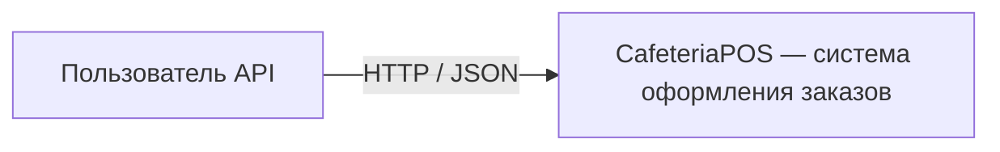
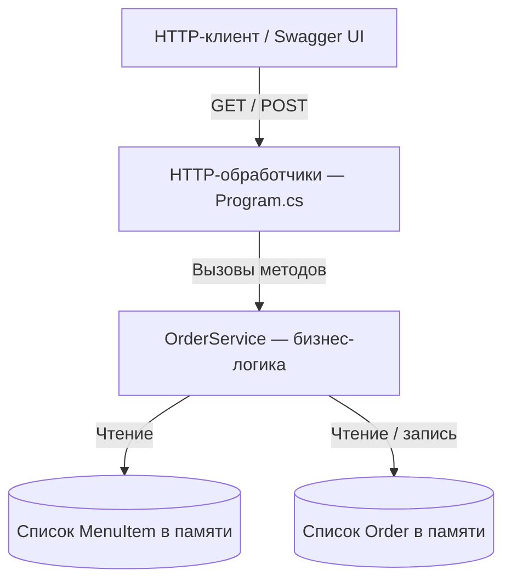
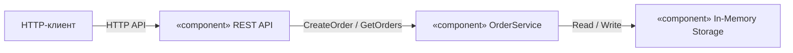
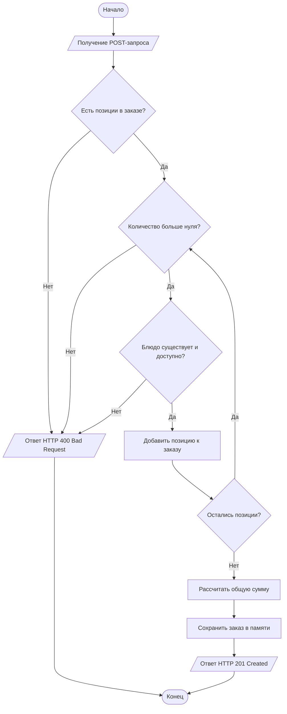
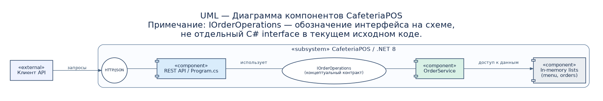
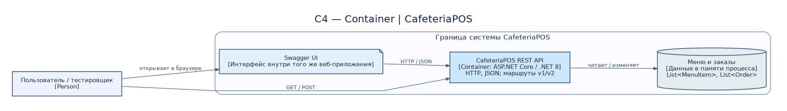
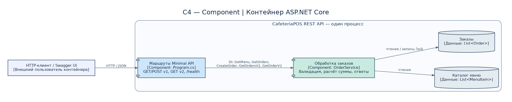
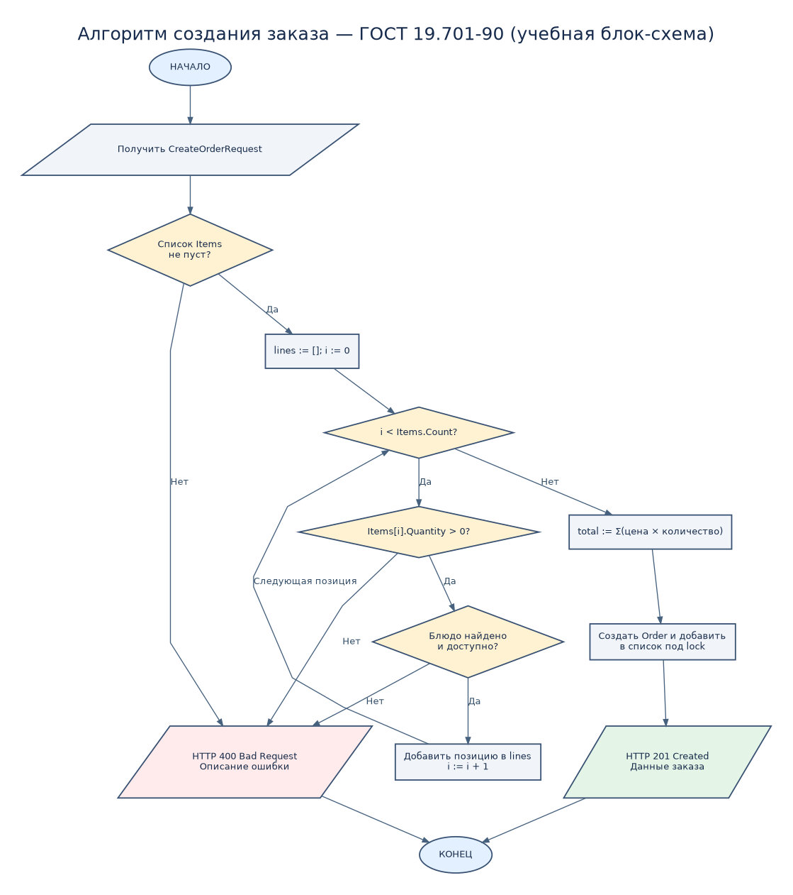

# Архитектура CafeteriaPOS

**МДК 03.02 — вариант №6**  
**Проект:** CafeteriaPOS  
**Технологии:** C#, .NET 8, ASP.NET Core Minimal API  
**Репозиторий:** https://github.com/Vanya1488/CafeteriaPOS-Variant6

## 1. Назначение системы

CafeteriaPOS — учебный REST API для оформления заказов в столовой. Приложение позволяет просматривать меню, создавать заказы, получать список заказов и запрашивать информацию об отдельном заказе.

Архитектура построена с разделением HTTP-обработчиков и бизнес-логики. Данные меню и заказов хранятся в оперативной памяти приложения.

## 2. Диаграмма C4 — уровень 1 (System Context)

Диаграмма показывает границы системы и её взаимодействие с пользователем.

**Пояснение:** пользователь отправляет HTTP-запросы к системе CafeteriaPOS и получает ответы в формате JSON. Swagger UI используется как инструмент взаимодействия с REST API.

## 3. Диаграмма C4 — уровень 2 (Container)

В текущей реализации все серверные компоненты выполняются внутри одного приложения .NET 8. Отдельная база данных отсутствует.

**Пояснение:** Swagger UI обслуживается приложением, а не является отдельным развёрнутым сервером. Хранилище данных находится в памяти процесса CafeteriaPOS.

## 4. Диаграмма C4 — уровень 3 (Component)

Диаграмма отражает внутреннее устройство серверного приложения.

**Пояснение:** Program.cs регистрирует маршруты и внедрение зависимостей. OrderService выполняет валидацию запросов, проверяет позиции меню, рассчитывает итоговую сумму и сохраняет заказы.

## 5. UML — диаграмма компонентов

Ниже приведена структурная схема компонентов с обозначением предоставляемых функций. Для строгого оформления UML по стандарту ISO/IEC 19505-2 диаграмму следует выполнить с нотацией компонентов и интерфейсов.

**Пояснение:** REST API предоставляет внешние HTTP-маршруты, OrderService реализует обработку заказов, а хранилище в памяти обеспечивает временное хранение данных. Это упрощённая схема компонентов; графическая UML-диаграмма с формальными символами интерфейсов может быть приложена отдельно.

## 6. Алгоритм создания заказа

**Пояснение:** запрос проверяется на наличие позиций; для каждой позиции проверяется количество и доступность блюда. После успешной проверки всех позиций рассчитывается сумма и формируется ответ 201. При ошибке возвращается 400.

Для отчёта по ГОСТ 19.701-90 рекомендуется отдельная блок-схема с условными графическими обозначениями и явным указанием цикла обработки каждой позиции.

## 7. Основные программные компоненты

| Компонент | Назначение | Реализация |
|---|---|---|
| Program.cs | Настройка приложения и маршруты | ASP.NET Core Minimal API |
| OrderService.cs | Валидация и оформление заказов | C# |
| MenuItem | Модель блюда | record |
| Order | Модель заказа | record |
| OrderLine | Позиция заказа | record |
| In-Memory Storage | Временное хранение данных | List<T> |
| Swagger UI | Документация и ручные проверки | Swashbuckle |
| CafeteriaPOS.Tests | Интеграционные проверки | xUnit |

## 8. Ограничения архитектуры

1. Данные заказов теряются после перезапуска сервера.
2. Отсутствует постоянная база данных.
3. Не реализованы пользовательские роли и авторизация.
4. Нет выделенного внешнего сервиса хранения или сообщений.
5. API V1 и V2 работают внутри одного веб-приложения.

## 9. Вывод

Разработанная архитектура соответствует масштабу учебного прототипа CafeteriaPOS. Выделение OrderService позволяет отделить бизнес-логику от конфигурации HTTP-маршрутов.

Модели C4 помогают рассмотреть систему на уровнях контекста, контейнеров и компонентов. UML-схема отражает основные программные части и их взаимодействие.

Архитектура может быть расширена посредством подключения PostgreSQL, введения авторизации и выделения дополнительных сервисов.

## 10. Графические материалы проекта

Для документирования архитектуры и алгоритмов CafeteriaPOS подготовлены отдельные графические схемы.

### 10.1. UML-диаграмма компонентов

[Открыть SVG](../CafeteriaPOS_Diagrams_Variant6/UML_COMPONENT.svg)

### 10.2. C4 — уровень Container

[Открыть SVG](../CafeteriaPOS_Diagrams_Variant6/C4_CONTAINER.svg)

### 10.3. C4 — уровень Component

[Открыть SVG](../CafeteriaPOS_Diagrams_Variant6/C4_COMPONENT.svg)

### 10.4. Блок-схема оформления заказа

[Открыть SVG](../CafeteriaPOS_Diagrams_Variant6/ORDER_FLOWCHART.svg)

Исходные DOT-файлы также доступны в папке CafeteriaPOS_Diagrams_Variant6. Они позволяют редактировать и повторно формировать схемы.
